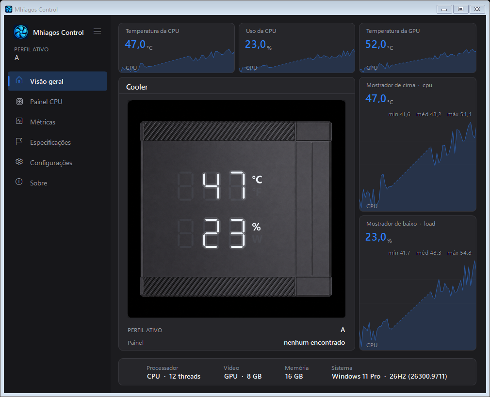
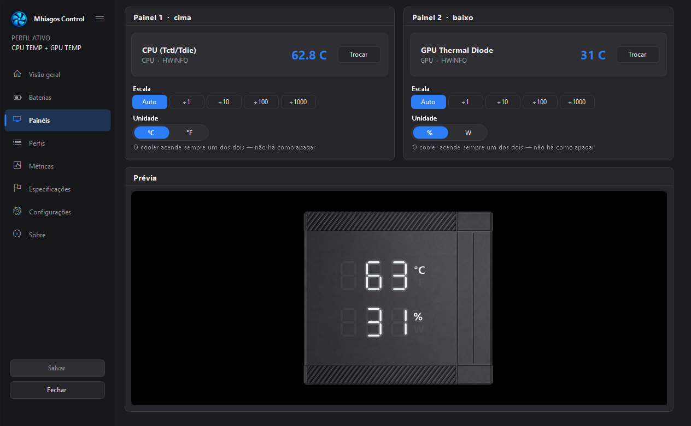
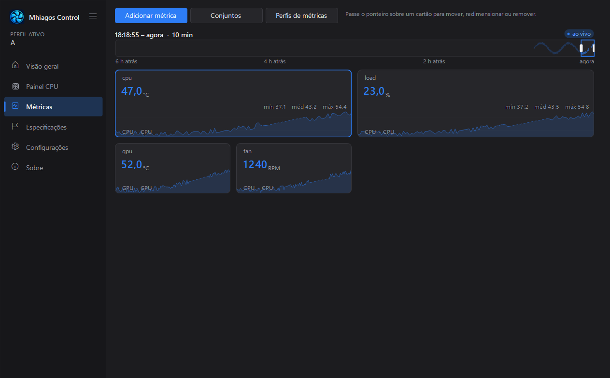
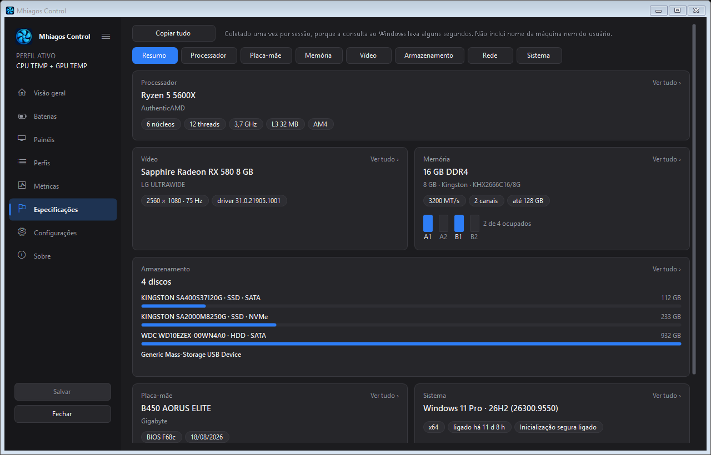
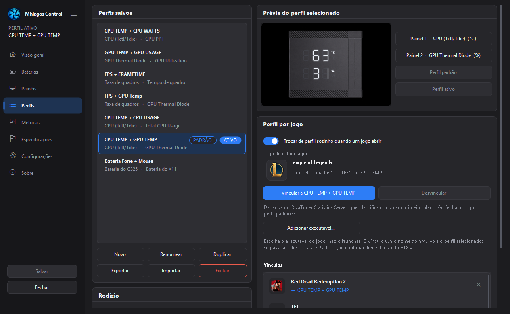
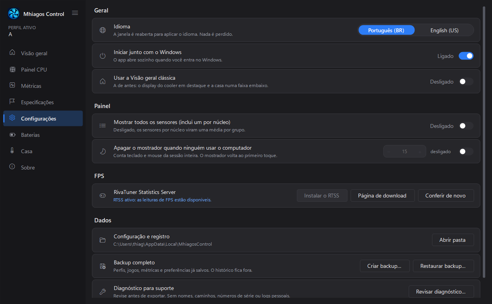
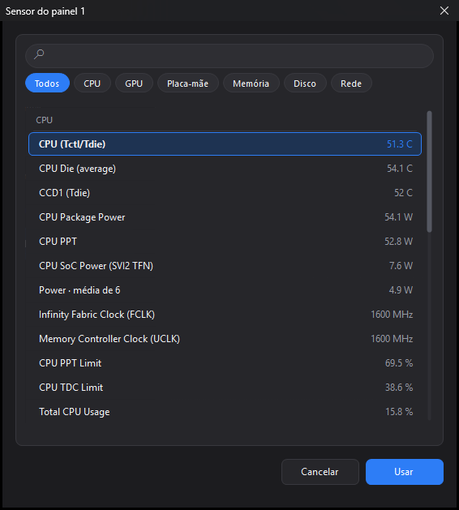
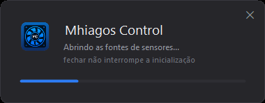

# Mhiagos Control

Driver alternativo para o painel dos **air coolers Rise Mode Temp 6, Temp 6 Pro
e Temp 8**, no lugar do software original *CPU TEMP Monitor*
(SHENZHEN SHINETEK, marca Ocypus).

Mostra **qualquer sensor** do sistema nos dois mostradores de 3 dígitos, em vez
das duas métricas fixas do software de fábrica. Tem perfis salvos, rodízio entre
eles, perfil automático por jogo e apagamento quando ninguém está usando o
computador. Além do cooler, guarda seis horas de histórico das leituras e monta o
retrato completo da máquina.



> **Edição enxuta (2.30.0-cpu).** Só o que importa para o cooler e para o PC:
> controle do painel (Painel CPU, com Perfis), Métricas e Especificações. Sem a
> página Casa, sem bateria de periféricos e sem widget. A edição completa, feita
> para o uso do próprio autor, está na branch `main` e nos releases sem o sufixo
> `-cpu`.


> A interface fala **português do Brasil e inglês**, escolhido pelo idioma do
> Windows na primeira execução e trocável em *Configurações*.

> Como o painel foi levantado, como os sensores são lidos e o que foi medido em
> vez de suposto está em **[docs/PROTOCOLO.md](docs/PROTOCOLO.md)**.

---

## Instalar

Baixe o `MhiagosControlSetup.exe` na
**[página de releases](https://github.com/Feurrado/MhiagosControl/releases/latest)**
e execute **como administrador**.

É um executável só, sem dependências: instala, cria o atalho e registra a
entrada em *Aplicativos Instalados*. O mesmo arquivo desinstala depois,
conservando os perfis. Rodar de novo por cima de uma instalação existente
atualiza no lugar.

> O executável não é assinado. O SmartScreen vai mostrar *"Editor
> desconhecido"*, e é preciso clicar em **Mais informações** e depois em
> **Executar assim mesmo**.

---

## Aparelhos compatíveis

- **Rise Mode Temp 6**
- **Rise Mode Temp 6 Pro**
- **Rise Mode Temp 8**

O painel é identificado pelo fabricante (**VID `1A2C`**, Shenzhen Shinetek)
somado à coleção HID *vendor-defined* `FF01`, que nenhum dispositivo comum
expõe. A mesma placa controladora sai em vários modelos da linha, com o mesmo
software de fábrica, então o casamento não depende do identificador exato de um
modelo. O modelo testado é o **Temp 6 Pro Black** (`VID 1A2C / PID 4984`).

A página *Sobre* mostra a versão e o `VID / PID` do painel encontrado. É a linha
para incluir numa [issue](https://github.com/Feurrado/MhiagosControl/issues) se
algo sair diferente do esperado no seu aparelho.

---

## Telas

A janela tem oito páginas na barra lateral e abre na **Visão geral**. A ordem é
sua: arraste um item para cima ou para baixo (ou use Ctrl+↑ e Ctrl+↓), e ela
fica gravada.

| Página | Responde |
|---|---|
| **Visão geral** | como a máquina está agora e o que o cooler está mostrando |
| **Painéis** | qual sensor vai para cada mostrador, com escala, unidade e prévia |
| **Perfis** | conjuntos salvos, rodízio, exportação e perfil por jogo |
| **Métricas** | cartões com histórico, conjuntos prontos e perfis de grade salvos |
| **Especificações** | o retrato completo da máquina, no espírito do CPU-Z |
| **Configurações** | idioma, início automático, ociosidade, FPS, backup e diagnóstico |
| **Sobre** | versão, painel encontrado, fontes de sensores e aviso legal |

*Salvar* e *Fechar* moram no pé da barra lateral; recolhida, os dois viram
ícone. *Salvar* fica esmaecido quando não há o que gravar, em vez de sumir. A
janela **redimensiona e lembra o tamanho** entre sessões, conferido contra o
monitor atual.

| | |
|:--:|:--:|
|  |  |
| **Painel CPU**: o sensor, a escala e a unidade de cada mostrador, com prévia | **Métricas**: a grade de cartões arrastáveis, com o navegador de período no alto seguindo o cartão escolhido |
|  |  |
| **Especificações**: as peças em destaque, com a marca da placa de vídeo, os slots de memória no lugar e os discos em barras | **Painéis**: o sensor de cada mostrador, a escala e as unidades, com prévia ao vivo sobre a peça |
|  |  |
| **Perfis**: a lista com rodízio de um lado, a prévia e o perfil por jogo do outro | **Configurações**: uma linha por opção, com a descrição curta e o controle à direita |

> As capturas saem do aplicativo, com as leituras que ele gravou na máquina do
> autor (um Ryzen 5 5600X com uma Radeon RX 580). O caminho da pasta de dados
> aparece como `%LOCALAPPDATA%` para não expor o nome de usuário.

### Visão geral

A tela que abre. Em cima, cinco leituras em destaque: temperatura e uso do
processador e da placa de vídeo, e uso da memória. Cada uma traz os últimos 5
minutos desenhados atrás e mínimo, média e máximo da janela. Um número sozinho
não diz se é alto: 72 °C é rotina sob carga e alarme em repouso, e é a curva
que separa os dois casos.

No centro, o mostrador do cooler ao vivo, com o perfil ativo e o painel
encontrado; ao lado, as duas leituras que vão para a peça, cada uma com o seu
histórico. Embaixo, uma tira com o retrato da
máquina: processador com núcleos e threads, placa de vídeo com a memória dela,
memória instalada, placa-mãe e a versão do Windows.

Nada aqui é editável: cada bloco tem a sua página, a um clique.

A prévia reproduz a vista superior do cooler e o mostrador de sete segmentos
como ele é no aparelho: os dois painéis empilhados, `°C`/`°F` sobre `%`/`W`,
dígitos brancos sem moldura.

### Escolha do sensor



O sensor de cada mostrador é escolhido numa janela dedicada, aberta pelo botão
*Trocar* em **Painéis**. Ali a lista não divide altura com escala, unidade e
prévia, e as pílulas de categoria reduzem a busca ao hardware procurado. A busca
por texto casa nome, categoria e tipo, todos os termos ao mesmo tempo. Duplo
clique ou <kbd>Enter</kbd> confirmam.

### Perfis

Um perfil é um par de sensores salvo junto com unidades e escala. A lista mostra
o que cada um manda para o mostrador, e selecionar um já exibe a prévia sobre a
peça antes de *Aplicar perfil* torná-lo o que está valendo. Aplicar grava na
hora, então um perfil ativo sempre sobrevive a fechar a janela. Todos aparecem
também no menu da bandeja, para trocar sem abrir a configuração.

*Exportar* grava o perfil selecionado num `.ini` avulso e *Importar* traz um de
volta, com nome livre se já houver outro igual. O identificador do sensor
carrega o modelo do hardware, então um perfil vindo de outra máquina entra com o
mostrador em branco, e o aplicativo avisa na hora.

#### Rodízio

Marcados dois ou mais perfis, o mostrador **gira entre eles** no intervalo
escolhido. Gira perfis inteiros, e não sensores dentro de um mostrador, porque o
indicador de unidade é do quadro: `°C`/`°F` em cima e `%`/`W` embaixo valem para
os dois painéis de uma vez. Girar só o sensor poria watts sob o indicador de
porcentagem.

O rodízio altera apenas o que aparece no mostrador; a configuração ativa
continua intacta e volta a comandar a peça quando a rotação é desligada.

#### Perfil por jogo

**Definir como padrão** escolhe o perfil de repouso do mostrador. Ligado, o
perfil por jogo **troca sozinho** quando um jogo abre e devolve esse padrão
quando ele fecha. Vem desligado: um recurso que mexe na peça sem ninguém pedir
tem de ser escolhido, não descoberto.

O casamento é pelo **executável**, não pelo título da janela, que muda com
patch, idioma e placar. Toda troca automática vai para o log com o motivo. Uma
troca manual durante o jogo não altera o destino de retorno: ao terminar, o
padrão volta.

Depende do RivaTuner Statistics Server, que identifica o jogo em primeiro
plano. Sem ele o cartão avisa e desabilita o interruptor.

### Especificações

O retrato completo da máquina, no espírito do CPU-Z, num mosaico com as peças em
destaque e o detalhe de cada uma em abas:

- **Processador**: família, modelo, stepping, soquete, cache L1/L2/L3 e
  virtualização.
- **Placa-mãe e BIOS**: versão e data.
- **Memória**: tipo, velocidade, canais e um pente por linha, com fabricante e
  número de peça. Os slots são desenhados no lugar de cada um, com o nome da
  placa (A1, A2, B1, B2) e o pente daquele slot ao passar o mouse, lidos da
  tabela SMBIOS da BIOS.
- **Vídeo**: a marca de quem montou a placa (Sapphire, ASUS, MSI e outras, pelo
  ID de subsistema), VRAM, VBIOS, device ID e driver.
- **Armazenamento**: SSD ou HDD, NVMe ou SATA, e o tamanho em barras.
- **Rede, monitores e sistema**.

Um botão copia tudo em texto, para colar num relatório.

Esta é a única parte do programa que usa WMI, e a coleta acontece **uma vez por
sessão, numa thread própria, quando a página abre pela primeira vez**:
`Win32_Processor` sozinho custa cerca de 1,4 s, e quem nunca abrir a página não
paga nada. Nome de máquina e de usuário ficam de fora de propósito, porque esta
tela existe para ser colada em relatório público.

Duas leituras vêm de onde talvez não se espere, porque a fonte óbvia erra. A
memória de vídeo sai do registro do driver, e não de `AdapterRAM`: aquele campo
é de 32 bits e devolve 4 GiB em qualquer placa maior que isso. O tipo de disco
sai do `MSFT_PhysicalDisk`, e não do `Win32_DiskDrive`, que chama todo disco de
"Fixed hard disk media" e classifica um NVMe como SCSI.

### Métricas

Uma grade de cartões com as leituras da máquina, cada um com o número grande e o
histórico desenhado atrás. Os cartões se **arrastam** para reordenar, e a grade
se reorganiza ao vivo em volta do que está na mão. Qualquer sensor pode virar
cartão, em três tamanhos que se acomodam sozinhos na largura disponível.

O botão *Conjuntos* oferece quatro pontos de partida: **Automático** pega uma
leitura de cada grandeza por peça; **Jogos** pergunta se está fluido e o que
segura; **Térmico**, o que esquenta e quanta energia entra para tanto;
**Silencioso**, por que a ventoinha acelerou. Um conjunto que não encontra nada
nesta máquina avisa e não mexe na grade.

O botão *Perfis de métricas* salva a grade atual com nome, ordem, tamanho dos
cartões e janela de histórico. Cada perfil salvo pode ser aplicado, atualizado,
renomeado ou excluído pelo mesmo menu.

O histórico **não vive na janela**: é gravado em disco e alimentado pelo mesmo
ciclo que atualiza o mostrador, então continua correndo com a configuração
fechada e sobrevive a fechar o programa. São seis horas em baldes de cinco
segundos. O **navegador de período**, no alto da página, desenha as seis horas
da métrica escolhida; arrastar as bordas da seleção muda o tamanho da janela (de
1 minuto a 6 horas), arrastar o meio volta no tempo e o duplo clique retorna ao
ao vivo. Clicar num cartão troca a faixa para ele, na cor dele, sem mexer no
trecho selecionado, e a escolha fica gravada.

Uma falha curta (até 30 s) é só uma leitura que não chegou, e a linha segue
cheia por cima dela. Um período longo sem leitura, com o app fechado ou o PC
desligado, vira uma **ponte tracejada e apagada** entre o último valor lido e o
próximo: diz que ali não houve medida sem deixar o gráfico em pedaços, e a
curva cheia fica só onde houve leitura.

O custo disso é medido: a leitura restrita ao mostrador visita só os grupos de
que ele depende, e uma vez a cada balde ela se abre para os grupos dos cartões,
tira a amostra e volta a fechar. Sem cartão nenhum na grade, nada disso roda.

### Quadros por segundo

Uma categoria **Jogos** com seis leituras: taxa de quadros, tempo de quadro, e
mínimo, médio e pior caso de cada um numa janela de 60 segundos. Servem tanto
para os cartões de *Métricas* quanto para o mostrador do cooler.

Quem mede é o
**[RivaTuner Statistics Server](https://www.guru3d.com/download/rtss-rivatuner-statistics-server-download/)**,
que publica o resultado num mapeamento de memória. É o mesmo caminho que o
HWiNFO e o Afterburner usam, e ler dele não exige privilégio nenhum. **Sem o
RTSS instalado não há FPS**: as leituras continuam na lista, sem valor, e o
rodapé de cada uma diz o que falta.

Vale para o jogo em primeiro plano; sem nenhum em primeiro plano, vale o último
que desenhou. Trocar de jogo reinicia a janela de 60 segundos.

**Instalar o RTSS pelo aplicativo.** Em *Configurações* há uma linha que mostra
se ele está publicando e um botão que entrega a instalação ao `winget`, numa
janela visível, com o comando à mostra. O instalador do Mhiagos Control oferece
o mesmo numa caixa **desmarcada**, que só aparece quando o RTSS ainda não está
lá e o `winget` existe.

Nos dois casos o passo final liga, no `Profiles\Config` do RTSS,
`StartWithWindows=1` e `StartMinimized=1`: ele passa a subir com o Windows
direto para a bandeja. O arquivo é preservado linha a linha, porque guarda
também o `FnOffsetCache`.

> O ajuste **encerra e reabre o RTSS**, porque ele reescreve esse arquivo ao
> sair. Por isso só acontece a pedido, nunca sozinho: derrubar o RTSS
> desengancha o jogo aberto.

O comando instala junto o **runtime do Visual C++**
(`Microsoft.VCRedist.2015+.x64`), que o RTSS exige e o pacote dele não declara.
Sem ele o `RTSSHooksLoader64` para em *"VCRUNTIME140_1.dll não foi encontrado"*.
Em máquina que já tem, o `winget` apenas diz que já tem.

> Se o runtime estiver **registrado mas com os arquivos ausentes** (acontece
> depois de um "limpador" ou de uma atualização que falhou), o `winget` vê a
> versão instalada e não repõe nada. Aí é preciso forçar uma vez, num terminal
> de administrador: `winget install --id Microsoft.VCRedist.2015+.x64 -e --force`

O instalador do RTSS **não vem embutido**: é freeware de outra pessoa e a
licença não dá direito de redistribuir. Pelo `winget` a origem é o repositório
da Microsoft e o pacote é o oficial (`Guru3D.RTSS`).

> As três estatísticas derivadas saem das **nossas** amostras, uma por segundo,
> e a janela está escrita no próprio rótulo. **Não são "1% low"**: aquilo exige
> o tempo de cada quadro, e nesta altura os quadros individuais já não existem.

> No mostrador do cooler, o número aparece certo mas o símbolo ao lado não: o
> quadro só acende `°C`/`°F` em cima e `%`/`W` embaixo, e
> [não há como apagá-los](docs/PROTOCOLO.md). 60 FPS embaixo aparece como
> `060` com o `%` ou o `W` aceso.

### Configurações

Uma linha por opção, com a descrição curta e o controle à direita, em quatro
grupos:

- **Geral**: idioma e iniciar junto com o Windows.
- **Painel**: mostrar todos os sensores (um por núcleo, em vez da média) e
  apagar o mostrador quando ninguém usar o computador.
- **FPS**: situação do RTSS, com os botões para instalar e conferir.
- **Dados**: a pasta de configuração, o **backup completo** (perfis, jogos,
  métricas e preferências já salvos; o histórico fica de fora) e o
  **diagnóstico para suporte**, revisado antes de exportar e sem nomes,
  caminhos, números de série ou logs pessoais.

O apagamento por ociosidade conta a sessão inteira do Windows, não este
programa. Assistir a um vídeo ou esperar uma renderização longa também conta
como ocioso, porque ninguém digita. O mostrador volta ao primeiro toque.

### Tela de carregamento



Não aparece sozinha: só surge se o ícone da bandeja for clicado enquanto as
fontes de sensores ainda estão abrindo. Fechá-la não interrompe nada.

---

## Requisitos

- Windows 10/11 x64
- .NET Framework 4.7.2+ (presente por padrão)
- **Privilégio administrativo**: ler temperatura da CPU exige acesso em modo
  kernel, e isso não existe sem elevação
- [PawnIO](https://pawnio.eu), opcional. Só importa sem o HWiNFO: sem ele a
  LibreHardwareMonitor não lê a temperatura da CPU

### Fontes de sensores

A fonte principal é a **biblioteca cliente do HWiNFO** que acompanha o software
de fábrica do cooler. Ela é comercial (© REALiX s.r.o.), licenciada ao fabricante
e não a este projeto, por isso **não está no repositório nem no instalador
publicado**. Se o *CPU TEMP Monitor* original estiver instalado, o aplicativo
oferece copiar a biblioteca de lá no primeiro arranque.

Sem ela, o aplicativo usa a
[LibreHardwareMonitor](https://github.com/LibreHardwareMonitor/LibreHardwareMonitor)
como fonte de reserva, e a página *Sobre* diz qual fonte está ativa.

---

## Usar

1. Execute o Mhiagos Control (pede elevação).
2. Na primeira execução abre a janela de configuração. Escolha o sensor de
   cada painel e as unidades.
3. O ícone fica na bandeja. Duplo clique reabre a configuração.

*Salvar* grava no disco e **deixa a janela aberta**, porque ajuste de mostrador
raramente vem sozinho. *Fechar* pergunta antes de descartar o que não foi salvo.

O software original não precisa estar instalado.

### Dados do aplicativo

Ficam em `%LOCALAPPDATA%\MhiagosControl\`, acessível pelo menu da bandeja em
*Abrir pasta de dados*:

| Arquivo | Conteúdo |
|---------|----------|
| `config.ini` | perfis do painel e de métricas, sensores, unidades, rodízio e idioma |
| `history.dat` | as seis horas de histórico das métricas |
| `log.txt` | diagnóstico, com rotação em 512 KB (`log.txt.1`) |

Configurações de versões antigas são migradas no primeiro arranque.

## O que este projeto evita do software original

- **Telemetria** para `upgrade-1318931438.cos.ap-beijing.myqcloud.com`
  (atualização automática de firmware e software a partir de um bucket na China)
- Métricas fixas: aqui qualquer sensor pode ir para qualquer painel
- A janela sempre aberta: aqui o programa vive na bandeja

---

## Compilar do código

Só para quem quer modificar o projeto. Para instalar, use o release acima.

Não exige SDK do .NET nem NuGet: compila com o `csc.exe` que já acompanha o
Windows. É o que mantém o projeto simples de construir, e a razão de o
instalador também ser compilado por ele em vez de por Inno Setup ou WiX.

```powershell
powershell -ExecutionPolicy Bypass -File .\build.ps1
```

Saída em `bin\MhiagosControl.exe`. O `-ExecutionPolicy Bypass` vale **apenas
para esse processo** e não altera a configuração da máquina.

> A pasta `bin\engine\` faz parte do conjunto. Copiar só o `.exe` faz o
> aplicativo perder temperatura, potência e clock da CPU: ele cai na fonte de
> reserva e avisa na página *Sobre*.

### Testes

```powershell
powershell -ExecutionPolicy Bypass -File .\tools\build-tests.ps1
```

Compila os testes contra os fontes do aplicativo e roda a suíte. É o mesmo passo
que o GitHub Actions executa a cada push e pull request, antes de montar o
instalador.

### Gerar o instalador

```powershell
powershell -ExecutionPolicy Bypass -File .\tools\build-installer.ps1
```

Saída em `dist\MhiagosControlSetup.exe`: um executável só, com o aplicativo e as
bibliotecas embutidos como recursos.

Ele grava em `Arquivos de Programas`, cria atalho no menu Iniciar, registra a
entrada em *Aplicativos Instalados* e, se pedido, cria a tarefa de início
automático. **O mesmo executável desinstala**: durante a instalação ele se copia
para a pasta de destino como `uninstall.exe`, e é esse caminho que vai para o
registro. A desinstalação **conserva os perfis por padrão**; apagar
`%LOCALAPPDATA%\MhiagosControl` é uma caixa desmarcada.

Se `lib\api-ms-win-core-sysinfo-825-64.dll` existir, ela entra **dentro** do
executável gerado, e esse instalador é só para uso próprio. A opção `-SemMotor`
produz um instalador sem ela, que é o publicado nas releases.

`dist\` fica fora do repositório pelo `.gitignore`: são artefatos de
compilação, e o release é o lugar deles.

### Ferramentas de desenvolvimento

Em `tools\`, cada uma com o seu `build-*.ps1`:

| Ferramenta | Para que serve |
|---|---|
| `Probe` | manda quadros crus ao painel, para mapear o protocolo |
| `RtssProbe` | separa as causas de "o FPS não aparece" na ponte com o RTSS |
| `Bench` | mede quanto o ciclo de atualização aloca, perto do que a biblioteca de sensores aloca |
| `MakeAssets` | gera os ícones e a imagem do cooler a partir das artes em `assets\` (`build.ps1 -Assets`) |
| `MakePeripherals` | desenha o ícone do Bluetooth; o G325 e o X11 saem de `assets\svg\` |

---

## Licença

**MIT**, veja [`LICENSE`](LICENSE). Use, modifique e redistribua à vontade,
mantendo o aviso de copyright.

A licença cobre **o código deste repositório**. As dependências têm licença
própria e não são cobertas por ela:

| Componente | Licença |
|------------|---------|
| `src/`, `tools/`, `build.ps1`, `assets/` gerados | MIT |
| `lib/LibreHardwareMonitorLib.dll` 0.9.6 | MPL 2.0 (veja `lib/LibreHardwareMonitor-LICENSE.txt`) |
| `lib/DiskInfoToolkit.dll`, `RAMSPDToolkit-NDD.dll`, `BlackSharp.Core.dll` | MPL 2.0 |
| `lib/HidSharp.dll` | Apache 2.0 |
| `lib/System.Memory.dll`, `System.Buffers.dll`, `System.Numerics.Vectors.dll`, `System.Runtime.CompilerServices.Unsafe.dll` | MIT (.NET Foundation) |
| `engine\api-ms-win-core-sysinfo-825-64.dll` (fora do repositório) | © REALiX s.r.o. |

---

## Créditos

- [LibreHardwareMonitor](https://github.com/LibreHardwareMonitor/LibreHardwareMonitor),
  fonte de reserva (MPL 2.0). Licença em `lib/LibreHardwareMonitor-LICENSE.txt`;
  as dependências dela estão listadas em `lib/THIRD-PARTY-NOTICES.txt`.
- **HWiNFO32 Client Library**, © REALiX s.r.o.
- Protocolo do painel: engenharia reversa para interoperabilidade com hardware
  próprio.
- Feito por [Feurrado](https://github.com/Feurrado).

---

## Isenção de responsabilidade

Este é um projeto **pessoal, independente e sem fins lucrativos**, feito para
interoperar com hardware que o autor possui. Não tem qualquer vínculo,
patrocínio, afiliação ou aprovação da Rise Mode, da Ocypus, da SHENZHEN
SHINETEK, da REALiX s.r.o. ou de qualquer outro
fabricante. Todas as marcas citadas pertencem aos seus respectivos donos e
aparecem apenas para identificar o equipamento com que o programa se comunica.

O protocolo do painel foi levantado por **engenharia reversa do próprio
equipamento**, com a finalidade exclusiva de interoperabilidade: o programa
não contém, não copia e não redistribui código do software original.

> O PROGRAMA É FORNECIDO "COMO ESTÁ", SEM GARANTIA DE QUALQUER TIPO, EXPRESSA OU
> IMPLÍCITA, INCLUINDO AS DE COMERCIALIZAÇÃO, ADEQUAÇÃO A UM FIM ESPECÍFICO E
> NÃO VIOLAÇÃO. O USO É POR CONTA E RISCO DE QUEM O EXECUTA. EM NENHUMA HIPÓTESE
> O AUTOR RESPONDE POR QUALQUER DANO, DIRETO OU INDIRETO, INCLUINDO DANO A
> EQUIPAMENTO, PERDA DE DADOS OU LUCROS CESSANTES, DECORRENTE DO USO OU DA
> IMPOSSIBILIDADE DE USO DESTE PROGRAMA.

Usar este programa pode implicar a **perda da garantia do equipamento**.
Verifique antes.

O mesmo texto aparece dentro do aplicativo, na página *Sobre*.
